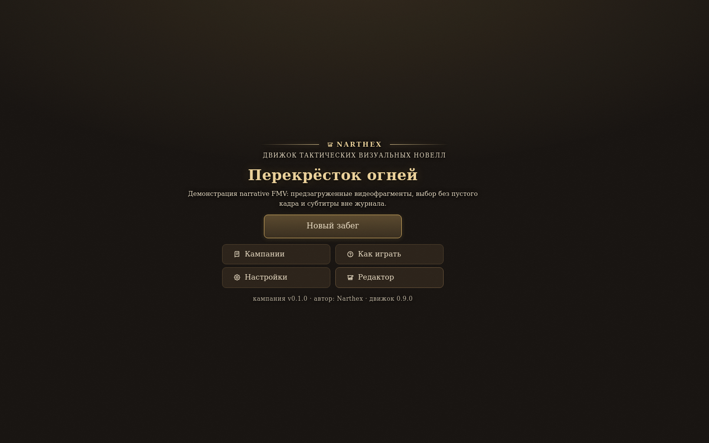

# NAR-3.6 — строгий аудит контракта FMV «Перекрёсток огней»

Дата: 2026-10-26. Ветка: `arena/e1c65272-narthex`. База: `4ecc72d591fa80664d1f06ebbabcd407945c3af7` (`main`).

Dispatch: `4056f0cf-5705-8175-a736-e2540255ca32`; run: `a42514cc-7f71-4764-81b7-14391dde0a31`.

## Реализация

- Добавлен отдельный валидатор FMV в `scripts/campaign-fmv-audit.mts`; базовые `src/editor/campaignAudit.ts` и `docs/campaign.schema.json` не изменялись. Пакетный NAR-3.2 FMV schema используется как основа, а её permissive choice extension в аудите сужен до реальных поддерживаемых полей.
- Явно проверяются `manifest.fmv` (безопасные имена, тип, уникальность, существование файлов), `scene.fmv` (ID и ссылка на объявленный документ), FMV-документ (`version: 1`, `id`, `start`, `fragments`), фрагмент (`id`, `src`, `poster`, `duration_ms`, `subtitles`, `choices`), субтитры, выборы и их `conds`/`sections`/`steps`/`effects`. Неизвестные ключи, condition/effect types и значения `mode` не принимаются. Проверяются уникальность ID, ссылки start/next, временные интервалы субтитров и локальные файлы всех `src`/`poster`.
- Legacy-аудитор получает отдельный in-memory view без двух расширенных `fmv` ключей; исходные объекты и файлы не меняются. Никакой ошибки не фильтруется по тексту: FMV-поля проходят отдельный строгий валидатор, а остальные ключи остаются под базовой закрытой схемой.
- `scripts/campaign-fmv-audit-smoke.mts` добавлен в `check:contracts`: он проверяет source CLI, standalone bundle, негативные мутации и обычную сцену без FMV. `public/ai/campaign-audit.mjs` пересобран.
- Не менялись `src/`, базовая схема, runtime FMV, `packs/adventure/`, данные/изображения Ash, oracle, эталон и данные самого `fmv-crossing`. Публичный index вручную не редактировался. `--no-audit` не добавлялся в штатные npm-команды.

## Аудит: до и после

Исходная проба до исправления, literal-вывод:

```text
$ npm run audit:campaign -- public/campaigns/fmv-crossing
Headless-аудит кампании: /home/user/narthex/public/campaigns/fmv-crossing
Файлов в покрытии: json 2, ink/md 0
Проверка Narthex — 10/26/2026, 4:58:05 PM

СТРУКТУРА И ССЫЛКИ
ERROR: Схема manifest.json/: must NOT have additional properties
ERROR: Схема scenes/scene_fmv_crossing.json/: must NOT have additional properties
МЕДИА И ФАЙЛЫ
INFO: Проверено ссылок на локальные медиа в контенте кампании: 1; все найдены. Проверка покрывает только упомянутые в данных пути — файлы на диске без ссылок не считаются и не удаляются.
ПЛЕЙТЕСТ
INFO: После текущей версии кампании плейтест не запускался.
INFO: Эта проверка не симулирует игровой маршрут. Для проверки взаимодействий используйте кнопку «Плейтест».
Итого: 2 ошибок, 0 предупреждений, 3 заметок
rc=1
```

Итоговая штатная проба после исправления, literal-вывод:

```text
$ npm run audit:campaign -- public/campaigns/fmv-crossing
Headless-аудит кампании: /home/user/narthex/public/campaigns/fmv-crossing
Файлов в покрытии: json 3, ink/md 0
Проверка Narthex — 10/26/2026, 5:15:36 PM

СТРУКТУРА И ССЫЛКИ
ПРОБЛЕМ НЕТ
МЕДИА И ФАЙЛЫ
INFO: Проверено ссылок на локальные медиа в контенте кампании: 1; все найдены. Проверка покрывает только упомянутые в данных пути — файлы на диске без ссылок не считаются и не удаляются.
INFO: Проверено FMV-ссылок на локальные медиа: 6; все найдены.
ПЛЕЙТЕСТ
INFO: После текущей версии кампании плейтест не запускался.
INFO: Эта проверка не симулирует игровой маршрут. Для проверки взаимодействий используйте кнопку «Плейтест».
Итого: 0 ошибок, 0 предупреждений, 4 заметок
rc=0
```

Итого: две исходные schema ERROR — ровно в `manifest.json` и `scenes/scene_fmv_crossing.json` — устранены без ослабления порога; итог `0 ERROR`, `0 warnings`, `4 info`.

## Негативные и положительные пробы

Все мутации делались во временных копиях; публичная кампания не менялась.

```text
$ npm run smoke:campaign-fmv-audit
  ✓ source FMV contract: rc=0; ERROR=0
  ✓ ordinary scene without FMV: rc=0; ERROR=0
  ✓ missing fragment src: rc=1; ERROR: Схема FMV fmv/fmv_crossing.json/fragments/0: must have required property 'src'
  ✓ unknown FMV mode: rc=1; ERROR: Схема FMV fmv/fmv_crossing.json/: must NOT have additional properties
  ✓ unknown choice field: rc=1; ERROR: Схема FMV fmv/fmv_crossing.json/fragments/0/choices/0: must NOT have additional properties
  ✓ unknown condition field: rc=1; ERROR: Схема FMV fmv/fmv_crossing.json/fragments/0/choices/0/conds/0: must NOT have additional properties
  ✓ standalone audit bundle: rc=0; ERROR=0
  ✓ standalone bundle rejects unknown mode: rc=1; ERROR: Схема FMV fmv/fmv_crossing.json/: must NOT have additional properties
✓ FMV audit smoke — source and bundle strict; missing src/unknown mode/unknown fields rejected; ordinary scene green
rc=0
```

Таким образом, отсутствие `src`, неизвестный режим/поле и неизвестное поле в условии возвращают ненулевой код с `ERROR`; обычная сцена без FMV остаётся зелёной.

## D-075: release → dev → release

Запускалась штатная `npm run campaign:release -- fmv-crossing --title 'Перекрёсток огней'` **без** `--no-audit`. Оба release прошли аудит источника с `0 ошибок, 0 предупреждений, 4 заметок`; на каждом шаге `check:dev-campaigns` и `check:campaigns` прошли. `campaign:dev` вернул полигон, последующий release восстановил штатную запись.

```text
INDEX_BEFORE_SHA256=0a200a6c72e809feedc5949fbf261861f6cef2eb6b02ba41f38f00f83ff357d3
campaign:release fmv-crossing: rc=0; реестр 1 → 1
campaign:dev fmv-crossing: rc=0; заголовок [DEV] Перекрёсток огней; реестр 1 → 0
campaign:release fmv-crossing: rc=0; реестр 0 → 1
INDEX_AFTER_SHA256=0a200a6c72e809feedc5949fbf261861f6cef2eb6b02ba41f38f00f83ff357d3
INDEX_DIFF=empty (byte-identical)
```

Literal-гейты в цикле: `Гейт внутренних кампаний: ok — 3 полигона, 1 записей в реестре, сирот нет.`, в dev: `... 0 записей ...`; `check:campaigns` каждый раз подтвердил `✓ публичные копии кампаний — артефакты паков: 3 из 3 сверены`. Индекс не редактировался вручную.

После финального release:

```text
$ npm run smoke:campaign-visibility
✓ smoke:campaign-visibility — dev/release/отказ работают
rc=0
```

## Браузерный playthrough и просмотренные кадры

После release собранный production preview прошёл полный маршрут:

```text
$ node scripts/visual/playthrough.mjs http://127.0.0.1:4173 out/play
Движок: Chromium 131.0.6778.0
Шагов: 20
PNG снимков: 20
pageerror: 0
Экранов ошибки: 0
Битых портретов: 0
Сырых id персонажей: 0
Итог: ok
✓ маршрут: 20 шагов, 0 находок
rc=0
```

PNG проекта, открытого после release из меню: [`NAR-3.6-fmv-project-open.png`](NAR-3.6-fmv-project-open.png). Полный набор локальных кадров и `report.md` находятся в `out/play/`.



Просмотрены и описаны четыре кадра из `out/play/`:

1. `01-fmv-project-open.png` — меню показывает название «Перекрёсток огней», описание и штатную кнопку «Новый забег»; ошибок/битых изображений нет.
2. `03-fmv-video-fragment-a.png` — первый видеоклип играет, субтитр расположен поверх видео, счётчик показывает «Фрагмент 1».
3. `04-fmv-post-fragment-choice.png` — оба читаемых варианта выбора показаны поверх сохранённого кадра; между клипом и выбором нет пустого экрана.
4. `07-fmv-ending.png` — финальная карточка сообщает о завершении фрагмента и предлагает «Продолжить».

В исходных Ash-полигонах изображения не восстанавливались и не копировались. Прямой audit каждой публичной Ash-кампании сохранил прежний результат: **27 media ERROR, 16 warnings, 2 info; rc=1** (одинаково для `ash-of-caerden` и `ash-of-caerden-adventure`). Это намеренно не исправлялось в NAR-3.6.

## Оракул и проверки

Ключевые literal-строки и коды возврата:

```text
npx tsc -b                                      rc=0 (stdout пуст)
контракты согласованы: 42 проверок              rc=0
check:packs passed                              rc=0
check:pack-boundary passed                      rc=0
check:campaign-formats: 125 типов, 192 файлов   rc=0
check:contracts                                 rc=0

npm run check:brand
✓ старое имя не встречается (проверено файлов: 1222)
rc=0

npm run check:version
✓ версия 0.9.0 согласована: package.json, lock, Cargo.toml, Tauri (../package.json), гайд, CHANGELOG
rc=0

npm run smoke:core
все якоря зелёные
rc=0

npm run build
✓ 1435 modules transformed.
✓ built in 2.69s
rc=0

npm run check:mission
SUMMARY 55/55 passed; rc=0
check:mission passed; rc=0

npm run check:campaigns
✓ adventure/ash-of-caerden-adventure: 101 файлов копии совпадают с паком
✓ narrative/ash-of-caerden: 100 файлов копии совпадают с паком
✓ narrative/fmv-crossing: 12 файлов копии совпадают с паком
✓ публичные копии кампаний — артефакты паков: 3 из 3 сверены
rc=0

npm run check:dev-campaigns
Гейт внутренних кампаний: ok — 3 полигона, 1 записей в реестре, сирот нет.
rc=0

npm run check:audit-bundle
✓ public/ai/campaign-audit.mjs matches scripts/campaign-audit.mts (1020401 bytes, sha256 9eeaf639977fa45ccc0147cbec25abf77df15566a7504b92828f2ce48f29f676)
rc=0

node public/ai/cf-play.mjs check public/campaigns/ash-of-caerden
ошибок 0 · предупреждений 8
rc=0

node public/ai/cf-play.mjs check public/campaigns/ash-of-caerden-adventure
ошибок 0 · предупреждений 8
rc=0
```

После `npm run pack:ai-kit` ZIP распакован во временный каталог. Запущенные **из распакованного набора** `campaign-audit.mjs` на `public/campaigns/fmv-crossing` и `cf-play.mjs check` завершились `rc=0`; первый сообщил `Итого: 0 ошибок, 0 предупреждений, 4 заметок`, второй — `ошибок 0 · предупреждений 0`. Пакет: `110 файлов, 2.80 МБ`, ZIP `0.60 МБ`.

Дополнительно: `npx oxlint scripts/campaign-audit.mts scripts/campaign-fmv-audit.mts scripts/campaign-fmv-audit-smoke.mts` — `Found 0 warnings and 0 errors`, `rc=0`. Общий `npm run lint` остаётся красным по существующим lint-замечаниям/ошибкам в других файлах репозитория (`1505 warnings`, `5 errors`, `rc=1`); новые audit-файлы в targeted lint чистые, unrelated lint-код вне Scope не менялся.
