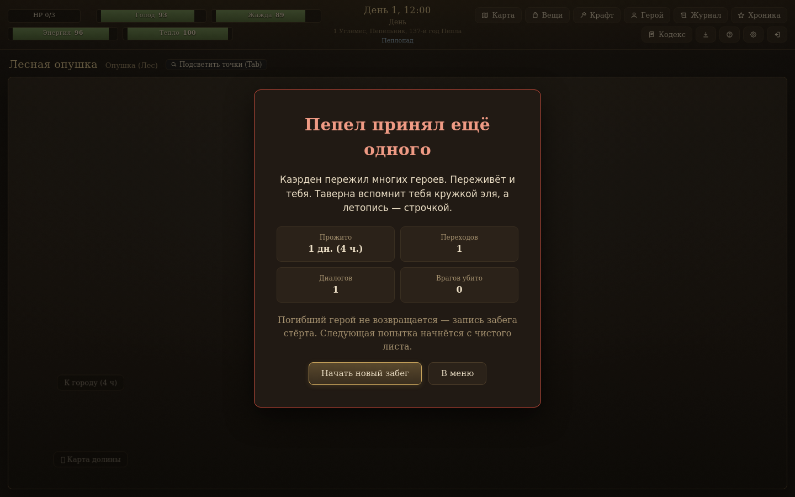
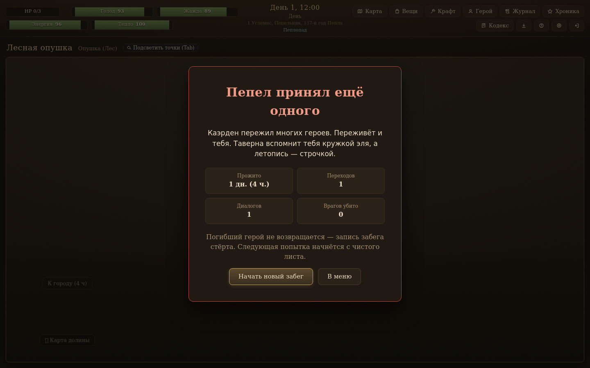
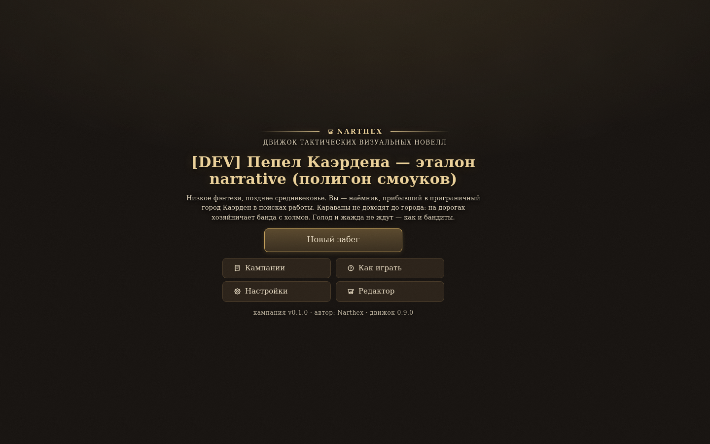
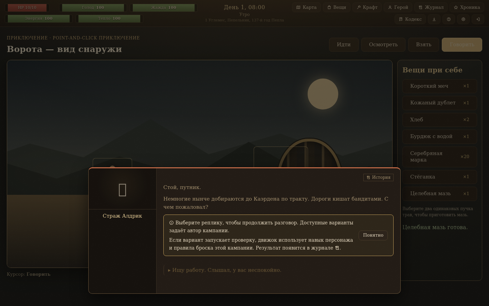
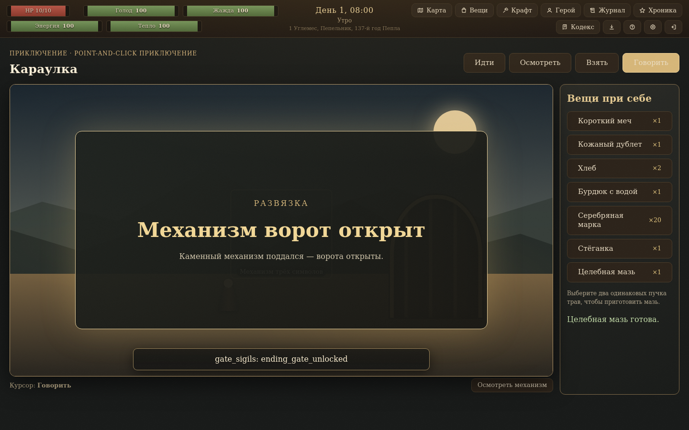

# NAR-3.7 — строгий браузерный экзамен Ash и Adventure

- **Дата:** 2026-10-26
- **Проверка:** `npm run playthrough:exam -- http://localhost:4173 out/nar37-followup`
- **Браузер:** Chromium 131.0.6778.0
- **Локальный итог:** **PASS**, exit code `0`; 2 пакета, 20 шагов, 0 находок.
- **PR:** [#79](https://github.com/Creative36711/narthex/pull/79), target `main`. CI artifact link will be added after the updated PR check finishes.

## Результаты

| Пак | Шаги | pageerror | Экраны ошибки | Битые `` | Пустые `src` | Raw NPC ID | Пустой каталог на старте | Известные отсутствия: путь / статус | Другие invalid image resources | Находки | Финал |
|---|---:|---:|---:|---:|---:|---:|---|---|---|---|---|
| `ash-of-caerden` | 8 | 0 | 0 | 0 | 0 | 0 | нет | `assets/img/scenes/gates_front_day.jpg` — 200; `assets/img/npc/aldric_neutral.jpg` — 200; `assets/img/maps/caerden_valley.jpg` — 200; `assets/img/scenes/forest_edge.jpg` — 200 | нет | нет | `ending_ashes` |
| `ash-of-caerden-adventure` | 12 | 0 | 0 | 0 | 0 | 0 | нет | `assets/img/scenes/gates_front_day.jpg` — 200; `assets/img/npc/aldric_neutral.jpg` — 200 | нет | нет | `ending_gate_unlocked` |

Все шесть известных отсутствий получили `Content-Type: text/html` от Vite SPA fallback; они напечатаны как path/status, но не классифицированы как findings. Их `200` не считается успешной загрузкой изображения. Resource oracle проверяет status **и** MIME type. Список исключений ограничен ровно заданными шестью путями; любой другой HTTP-ошибочный image resource, ответ не `image/*`, или неудачный image request остаётся находкой и делает экзамен красным.

`console.error` не подавлялся: экзамен записал 6 сообщений для Ash и 4 для Adventure. Это ошибки загрузки известных отсутствующих изображений, видимые в literal stdout и отчёте JSON. Fallback отображает явную заглушку, сохраняет failed URL в диагностических атрибутах/событиях и не меняет сетевой ответ или `naturalWidth` на успешное значение. Ошибка сцены не оставляет отдельную ошибочную плашку поверх fallback; сообщение остаётся в консоли, а статус/MIME — в отчёте. На странице нет broken или empty-src ``.

## Маршрут Ash и финал

Ash проходит реальный UI: выбор пакета, создание героя, стартовая сцена и диалог, карта, переход к лесной опушке, итоговый экран. **Допущение:** критерий не закрепляет боевую тактику/выживание героя, поэтому для воспроизводимого доступа к существующему `ending_ashes` выбран допустимый минимальный профиль характеристик и фиксированный seed только в browser harness; штатная кампания и UI остаются реальными. Для повторяемости используется обычный игровой seed (`Math.random() = 0.5` → seed `i`) и через штатные controls создания героя выбираются допустимые минимальные `CON/SIZ/DEX` (итоговые 3 HP). Однократная штатная засада `rule_forest_ambush` и обычная логика инициативы/боя завершают этот забег существующей концовкой `ending_ashes` до монтирования `CombatScreen`; не запрашиваются `assets/img/arenas/forest_road_topdown.jpg`, `assets/img/npc/bandit_neutral.jpg` и `assets/img/npc/player_portrait.jpg`, и ни один из них не добавлен в whitelist. Кампания и боевые данные не менялись. Если появится любой неожиданный image request, strict oracle отметит его как finding и завершится с ошибкой.

Финальный экран Ash: **«Пепел принял ещё одного»**. Adventure достигает **`ending_gate_unlocked` / «Механизм ворот открыт»**.

Полный буквальный вывод строгого экзамена: [`NAR-3.7-strict.stdout.txt`](./NAR-3.7-strict.stdout.txt). Полный машинный JSON/Markdown, PNG всех 20 шагов и `exam.stdout.txt` этого запуска сохранены в `out/nar37-followup/`.

## Кадры браузера

| Пак и шаг | Кадр |
|---|---|
| Ash — непустое стартовое меню |  |
| Ash — прибытие в лес / состояние перед финалом |  |
| Ash — `ending_ashes` |  |
| Adventure — непустое стартовое меню |  |
| Adventure — разговор со стражником |  |
| Adventure — `ending_gate_unlocked` |  |

## Изолированная mutation probe

Создана временная fixture-копия `public/campaigns`; в копии Adventure NPC-портрет Aldric изменён на несуществующий `assets/img/npc/nar37-missing-probe.png`. Exam запускался только в `--adventure` режиме с `--fixture-root=<temporary copy>`. Он достиг `ending_gate_unlocked`, зафиксировал неожиданный `HTTP 404` как finding и вернул `1`. Вывод напечатал точный URL:

`http://localhost:4173/campaigns/ash-of-caerden-adventure/assets/img/npc/nar37-missing-probe.png`

Временная копия удалена; сравнение `git status --short` до/после самой probe совпало (`WORKTREE_UNCHANGED=yes`). Raw evidence, включая finding и маркер `MUTATION_PROBE_RC=1`, — [`NAR-3.7-mutation.stdout.txt`](./NAR-3.7-mutation.stdout.txt). Ни один campaign-файл в рабочем дереве не менялся.

## Неизменённый legacy oracle

Запуск ровно старой командой на dev preview:

```text
$ npm run playthrough -- http://localhost:4173 out/play
✓ маршрут: 20 шагов, 0 находок
exit code: 0
```

Дополнительно production preview (`npm run preview -- --host 0.0.0.0 --port 4174 --strictPort`) прошёл тот же legacy-маршрут: 20 шагов, 0 находок, rc `0`; строгий production-preview exam также дал 20 шагов и 0 findings.

## Проверки и базовые оракулы

| Проверка | Результат |
|---|---|
| `npx tsc -b` | rc `0` |
| `npm run check:contracts` | rc `0` |
| `npm run check:brand` | rc `0` |
| `npm run check:version` | rc `0` |
| `npm run smoke:core` | rc `0` |
| `npm run build` | rc `0` |
| `npm run check:mission` | rc `0`; 55/55 mission smokes прошли; включая `check:guide`, `check:narrative-codes`, оба `cf-play check` baseline |
| `node public/ai/cf-play.mjs check public/campaigns/ash-of-caerden` | rc `0`; 10 сцен, 8 локаций, 6 диалогов, 21 Ink, 0 ошибок / 8 предупреждений |
| `node public/ai/cf-play.mjs check public/campaigns/ash-of-caerden-adventure` | rc `0`; 10 сцен, 8 локаций, 6 диалогов, 21 Ink, 0 ошибок / 8 предупреждений |
| распакованный `__chronicle_ai__-kit.zip`: `cf-play check` по `examples/narrative` | rc `0`; 0 ошибок / 8 предупреждений; временный каталог распаковки удалён |

## Область изменений

Изменения ограничены strict browser harness, минимальными player-view fallback в `src/player/GameView.tsx` и `src/player/MapScreen.tsx`, decision record и этим evidence report. В commit не включаются campaign data, `assets/img/**`, `packs/`, `public/campaigns/index.json`, schema, core или oracle §1; намеренно отсутствующие изображения не восстанавливались.

## CI и закрытие фазы 2

Workflow [`.github/workflows/visual.yml`](../../.github/workflows/visual.yml) запускает обе браузерные проверки и сохраняет `out/visual` в CI artifact `visual-report`. После завершения обновлённого PR #79 сюда и в [`docs/phases.md`](../../docs/phases.md) будет добавлена ссылка на успешный run/artifact; фаза 3 остаётся закрытой.
